# Low Poly Brazil Buildings Kit: free CC0 low poly 3D buildings of a Brazilian town

🇬🇧 English · **🇧🇷 [Leia em português](README.pt-BR.md)**

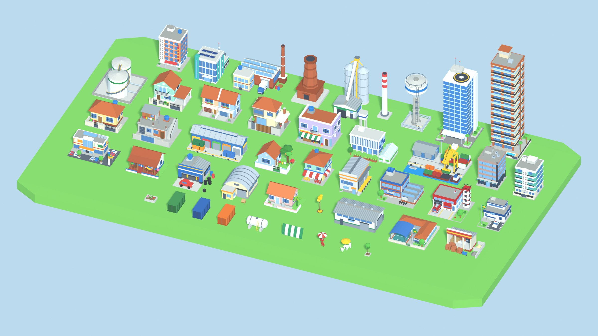

▶️ **[Watch the video on YouTube](https://www.youtube.com/watch?v=HUA-u5IVFIA)** · **[Download on itch.io](https://kkyqr.itch.io/low-poly-brazil-buildings-kit)** (free, optional donation)

> **Short answer:** the Low Poly Brazil Buildings Kit (*Kit Prédios Brasil Low Poly*) is a **free, public domain
> (CC0 1.0)** pack of **45 low poly 3D buildings in glTF/GLB** that look like a **Brazilian town**: single-storey
> houses with clay tile roofs, walls and iron gates, *sobrados*, self-built brick houses with a rooftop water tank,
> 1970s apartment blocks with tiled facades, a corner bakery with striped awnings, glass office towers, sheds with
> fiber-cement roofs, a sawtooth-roof factory, the goblet-shaped concrete water tower of interior towns, a state
> school with a covered sports court, a fire station, a river port, containers, tanks and chimneys. Every model has
> **1,500 triangles or fewer**, flat colors and no textures. Works in Godot, Unity, Unreal, three.js, Babylon.js
> and Blender. Commercial use is allowed and attribution is optional.

Most free city kits look North American or European. This one was made because a Brazilian educational game,
[Guardião da Água](https://github.com/kayquer/guardiao_da_agua_js), needed neighborhoods that Brazilian students
recognize: **pastel walls, terracotta roofs, blue fiber water tanks, window grilles, steel roll-up shop doors,
*cobogó* and *pastilha* facades**. It is ready for **city builders, simulation and tycoon games, educational games,
architectural sketches, game jams and prototypes**.

**Public domain ([CC0 1.0](LICENSE)).** Use it however you like, in personal, educational or commercial
projects; modify and redistribute it. Attribution is optional (see [CITATION.cff](CITATION.cff)). No warranty.

**Contents:** [How to use](#how-to-use) · [Catalog](#catalog) · [Build or modify](#build-or-modify-the-models) ·
[FAQ](#faq) · [Origin and credits](#origin-and-credits)

> File and folder names are in Portuguese (for example `residencial/casa_terrea.glb` = single-storey house). The
> catalog below lists every file with its English name.

## How to use

- Download the repository (**Code → Download ZIP**) or just the `.glb` files you need from [`models/`](models).
- **Scale:** a house is about **1.3 units wide and 0.8 tall**; the exact size of every model (width, depth,
  height) is in [`tools/alvos.json`](tools/alvos.json). Models of the same group share one scale, so pieces can be
  combined into lots and blocks. In Guardião da Água 1 unit = 0.65 grid cells.
- **Orientation:** Y up, building front facing **-Z** (glTF convention); the right side (+X) is finished too,
  made for isometric cameras. Every model is centered and stands on y = 0.
- **Materials:** one material per color (PBR, base color only, roughness 0.85). To draw a whole neighborhood in a
  few draw calls, convert material colors into vertex colors and merge or instance the buildings.
- **Budget:** buildings have 700–1,460 triangles; details (containers, awnings, parasols, trees) 78–540. Every file
  is under 100 KB.
- **Mix and match** with the sibling kits: [Low Poly Brazil Props Kit](https://github.com/kayquer/kit-props-brasil-lowpoly)
  (street props, nature, pollution signs), [Threatened Fauna Low Poly Kit](https://github.com/kayquer/kit-fauna-ameacada-lowpoly)
  (Brazilian threatened species) and [Low Poly City Kit](https://github.com/kayquer/kit-cidade-lowpoly) (water,
  sanitation and energy buildings).

## Catalog

<!-- catalogo:inicio -->
**45 models** in 7 categories.

### Residential · Residencial (9)

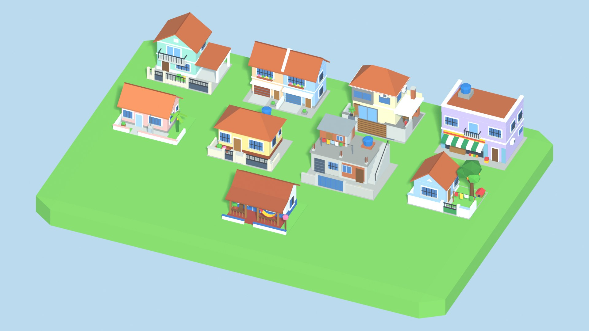

| | Model | Description | Tris |
|---|---|---|---:|
| 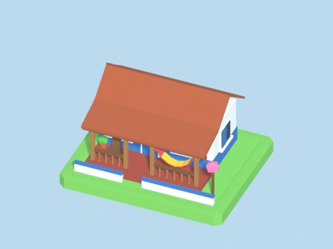 | [`casa_alpendre`](models/residencial/casa_alpendre.glb) | House with a front porch (alpendre), wooden pillars, hammock and blue shutters | 984 |
| 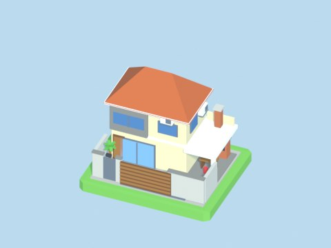 | [`casa_dois_andares`](models/residencial/casa_dois_andares.glb) | Newer two-storey house with gourmet area, split AC units and sliding gate | 932 |
| 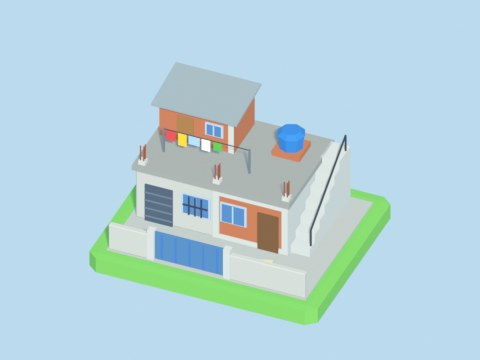 | [`casa_laje`](models/residencial/casa_laje.glb) | Self-built house: exposed brick, flat slab with rebar, rooftop water tank and clothesline | 1100 |
| 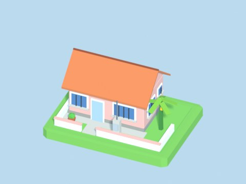 | [`casa_popular`](models/residencial/casa_popular.glb) | Small social-housing house in pastel pink with a meter post and banana tree | 704 |
| 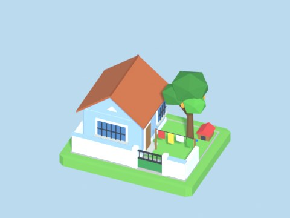 | [`casa_quintal`](models/residencial/casa_quintal.glb) | House with side yard: mango tree, clothesline and doghouse | 1052 |
| 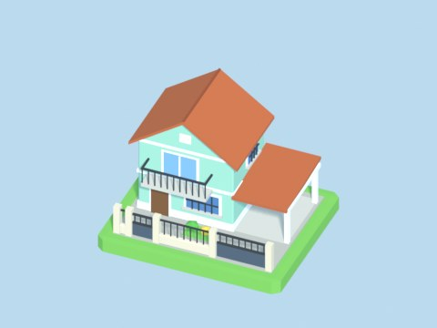 | [`casa_sobrado`](models/residencial/casa_sobrado.glb) | Two-storey sobrado with iron-railed balcony and covered garage | 1284 |
| 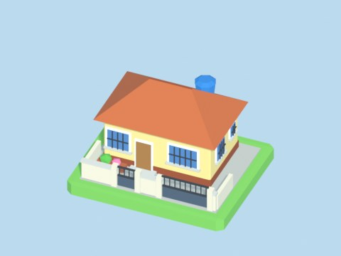 | [`casa_terrea`](models/residencial/casa_terrea.glb) | Single-storey house with clay tile hip roof, low front wall, iron gate and blue water tank | 1048 |
| 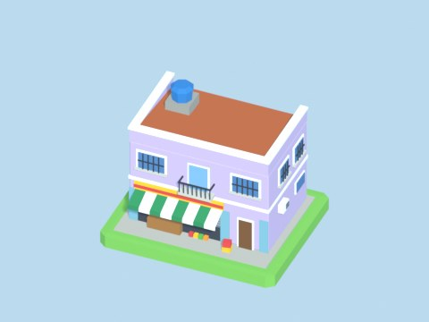 | [`sobrado_comercio`](models/residencial/sobrado_comercio.glb) | Mixed-use sobrado: corner shop with roll-up steel door below, home above | 1252 |
| 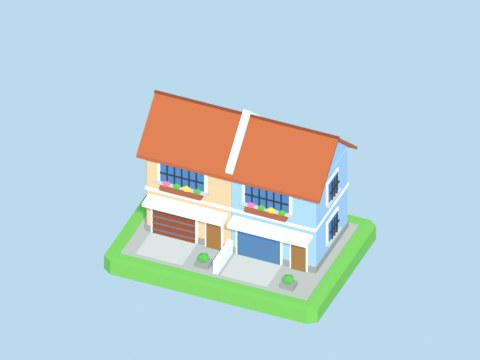 | [`sobrados_geminados`](models/residencial/sobrados_geminados.glb) | Pair of attached townhouses in peach and pastel blue with garage doors | 1184 |

### Commercial and apartment buildings · Comércio e prédios (7)

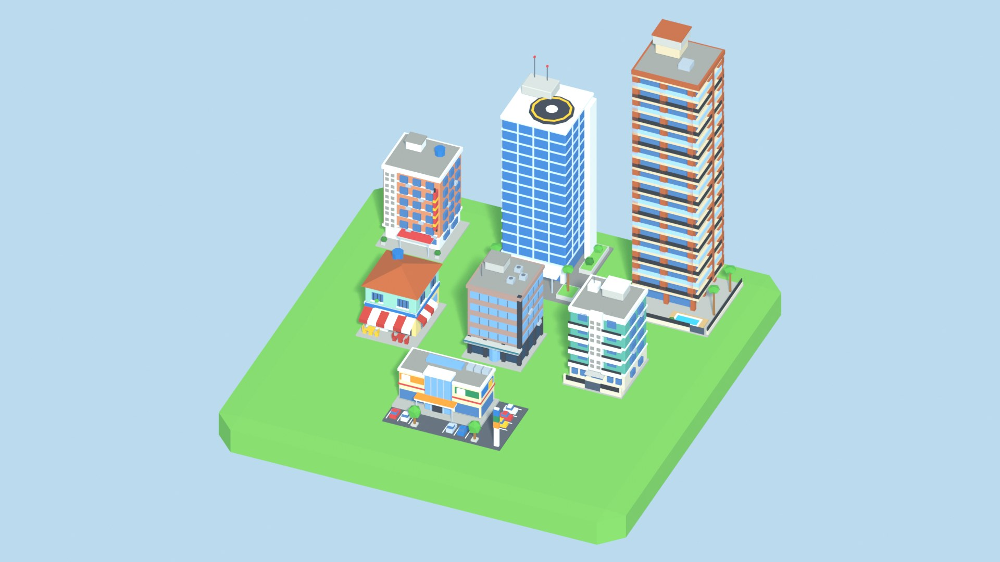

| | Model | Description | Tris |
|---|---|---|---:|
| 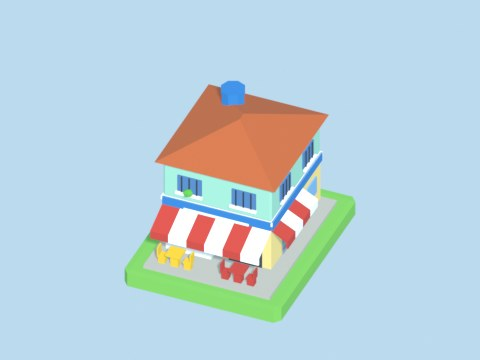 | [`padaria_toldo`](models/comercial/padaria_toldo.glb) | Corner bakery with striped awnings, roll-up door and plastic sidewalk tables | 1024 |
| 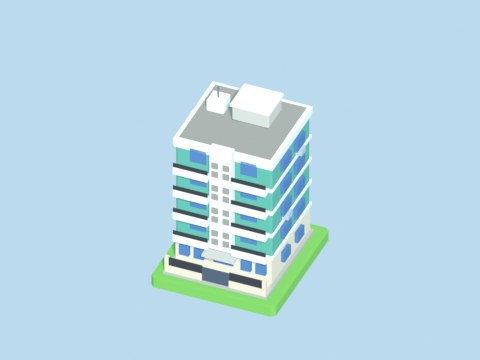 | [`predio_apartamentos`](models/comercial/predio_apartamentos.glb) | Four-storey walk-up apartment block (BNH/COHAB style) with tiled facade and balconies | 1176 |
| 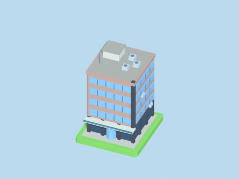 | [`predio_banco`](models/comercial/predio_banco.glb) | Granite office block with a smoked-glass bank branch on the ground floor | 964 |
| 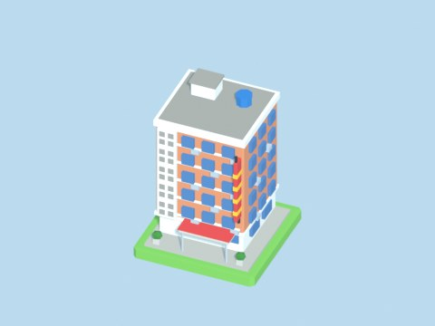 | [`predio_hotel`](models/comercial/predio_hotel.glb) | Five-storey hotel with cobogó strip, AC units and vertical sign | 1328 |
| 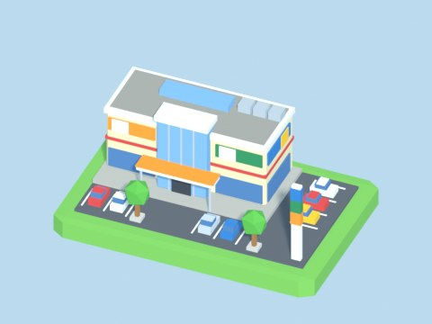 | [`shopping`](models/comercial/shopping.glb) | Neighborhood shopping mall with glass atrium and parking lot | 992 |
| 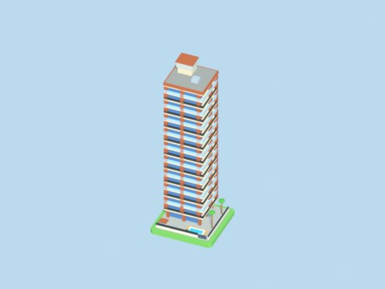 | [`torre_alta`](models/comercial/torre_alta.glb) | 18-storey residential tower with balconies, pool and rooftop water tank | 1224 |
|  | [`torre_escritorios`](models/comercial/torre_escritorios.glb) | Blue glass office tower with helipad and plaza | 984 |

### Industrial and sheds · Indústria e galpões (11)

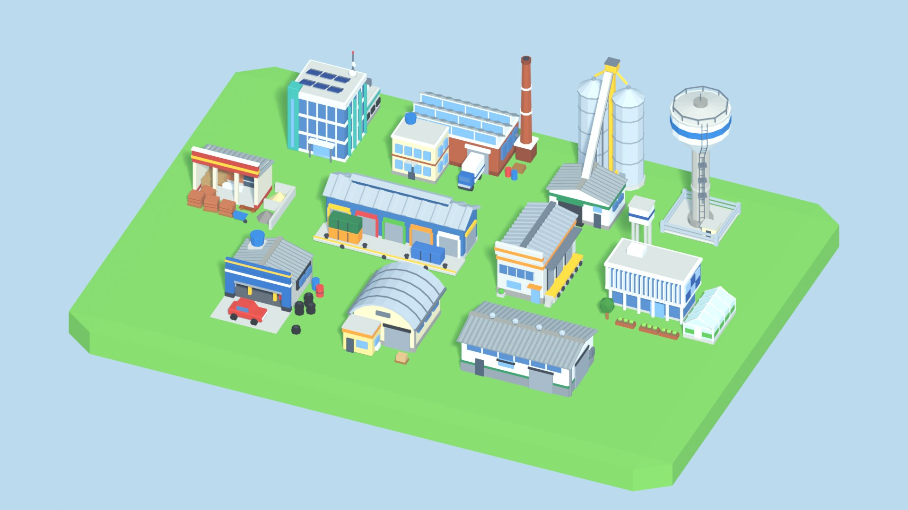

| | Model | Description | Tris |
|---|---|---|---:|
| 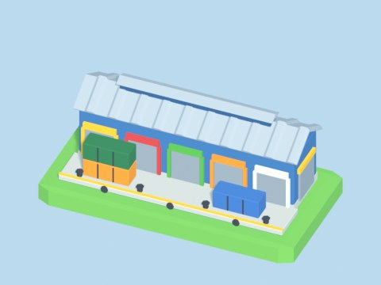 | [`armazem_porto`](models/industrial/armazem_porto.glb) | Blue port warehouse with colored roll-up gates and quay | 1316 |
| 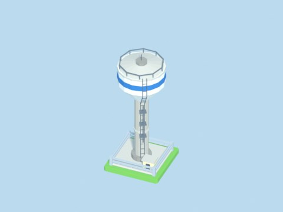 | [`caixa_dagua_taca`](models/industrial/caixa_dagua_taca.glb) | Concrete goblet-shaped elevated water tower (taça) of interior towns | 1300 |
| 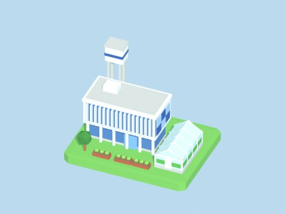 | [`centro_pesquisa`](models/industrial/centro_pesquisa.glb) | Modernist public research institute with brises and greenhouse | 1344 |
| 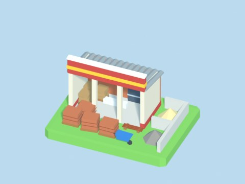 | [`deposito`](models/industrial/deposito.glb) | Building-materials depot with brick pallets, sand and cement bags | 910 |
| 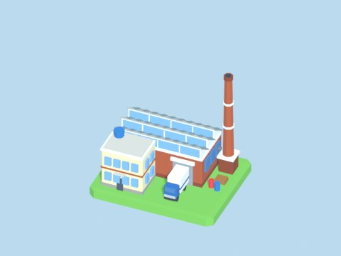 | [`fabrica`](models/industrial/fabrica.glb) | Brick factory with sawtooth roof, tall chimney, office block and truck | 1392 |
| 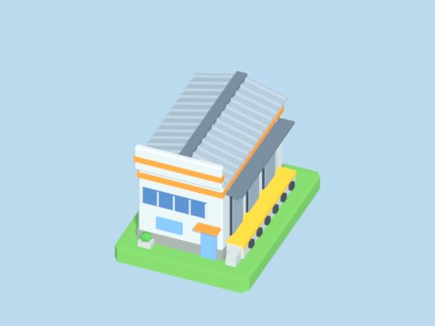 | [`galpao_carga`](models/industrial/galpao_carga.glb) | Distribution warehouse with three loading docks | 1096 |
| 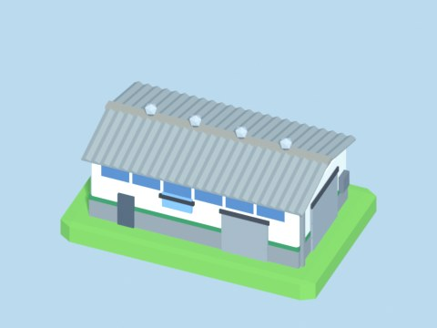 | [`galpao_comprido`](models/industrial/galpao_comprido.glb) | Long fiber-cement shed with ribbon windows and roof vents | 920 |
| 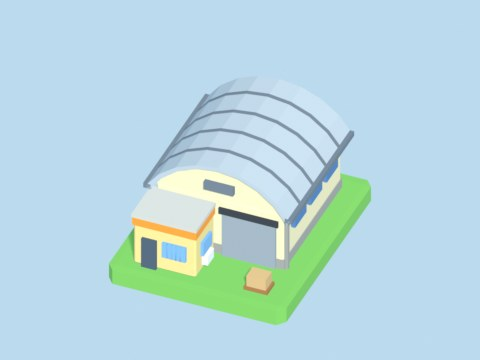 | [`galpao_pequeno`](models/industrial/galpao_pequeno.glb) | Small curved-roof shed with roll-up door and office | 804 |
| 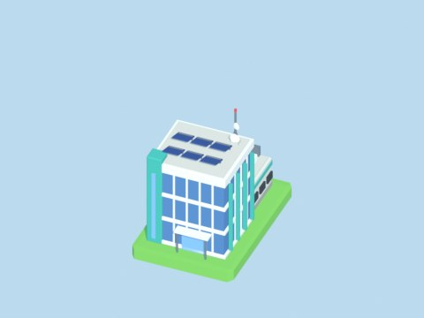 | [`galpao_tecnologia`](models/industrial/galpao_tecnologia.glb) | Tech-park building with solar panels, stair tower and server annex | 1272 |
| 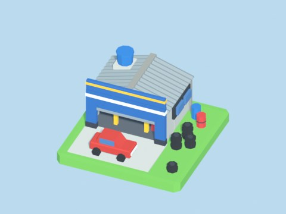 | [`oficina`](models/industrial/oficina.glb) | Car repair shop with open bay, car lift, tires and oil drums | 1344 |
| 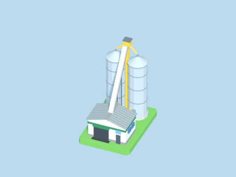 | [`silo_industria`](models/industrial/silo_industria.glb) | Feed mill with two metal silos, grain elevator and conveyor | 1236 |

### Public buildings · Prédios públicos (5)

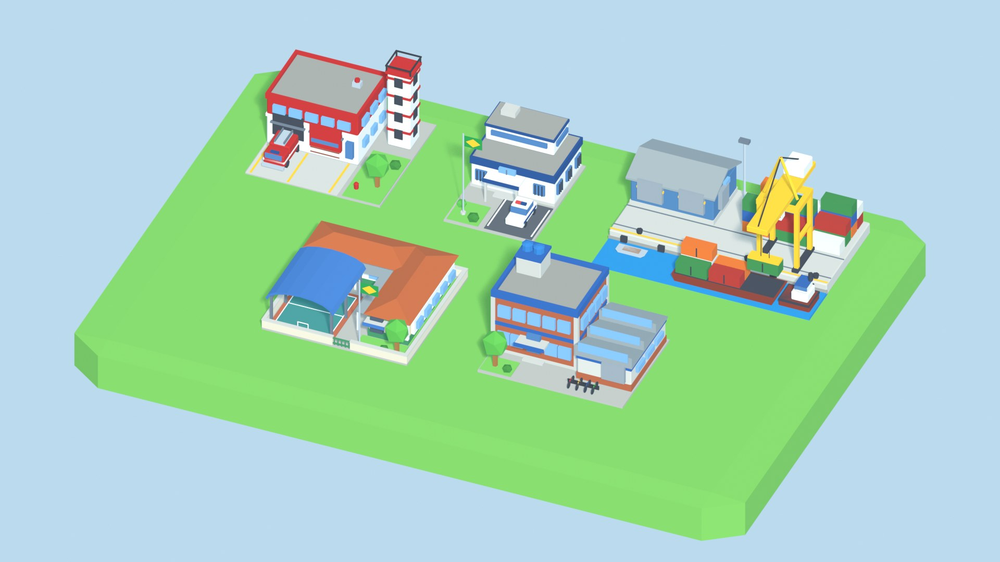

| | Model | Description | Tris |
|---|---|---|---:|
| 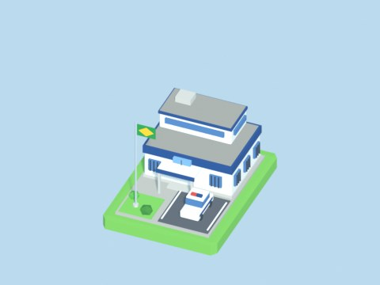 | [`delegacia`](models/publico/delegacia.glb) | Police base, white with blue band, with patrol car | 808 |
| 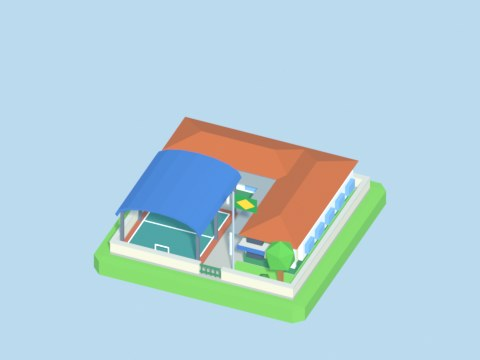 | [`escola_estadual`](models/publico/escola_estadual.glb) | L-shaped state school with covered sports court and flag | 1176 |
| 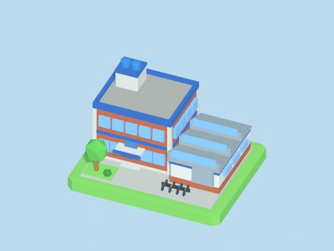 | [`escola_tecnica`](models/publico/escola_tecnica.glb) | Technical school with exposed brick, sawtooth workshop and bike rack | 1128 |
| 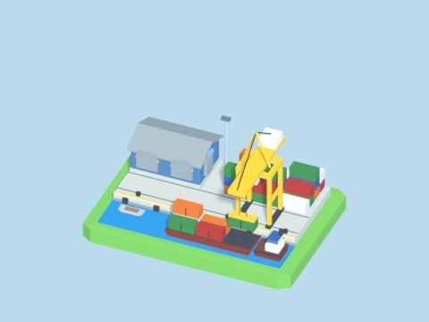 | [`porto`](models/publico/porto.glb) | River port with gantry crane, warehouse, containers and barge | 1460 |
| 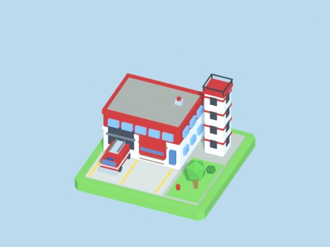 | [`quartel_bombeiros`](models/publico/quartel_bombeiros.glb) | Fire station with red truck and training tower | 1096 |

### Street greenery · Verde de calçada (3)

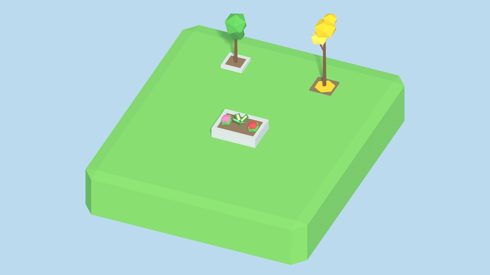

| | Model | Description | Tris |
|---|---|---|---:|
| 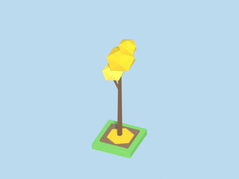 | [`arvore_ipe`](models/verde/arvore_ipe.glb) | Yellow ipê street tree with fallen flowers | 120 |
| 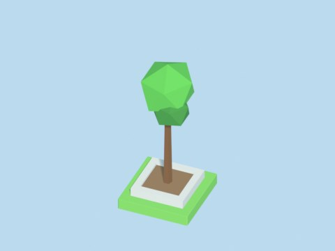 | [`arvore_pequena`](models/verde/arvore_pequena.glb) | Small street tree (oiti) in a concrete pit | 116 |
| 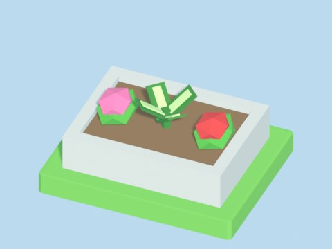 | [`jardineira`](models/verde/jardineira.glb) | Concrete sidewalk planter with tropical plants and impatiens | 248 |

### Shop furniture · Mobiliário de comércio (3)

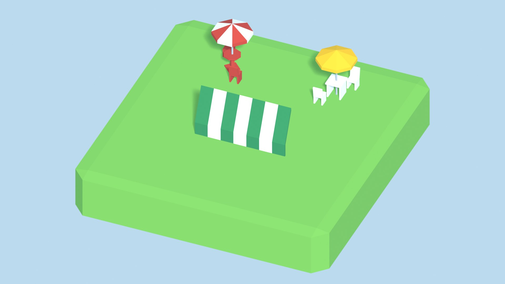

| | Model | Description | Tris |
|---|---|---|---:|
| 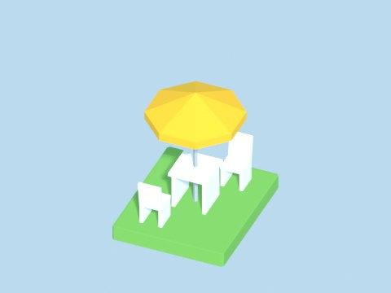 | [`guarda_sol_a`](models/mobiliario/guarda_sol_a.glb) | Yellow bar parasol with white plastic table and chairs | 174 |
|  | [`guarda_sol_b`](models/mobiliario/guarda_sol_b.glb) | Red bar parasol with red plastic table and chairs | 190 |
| 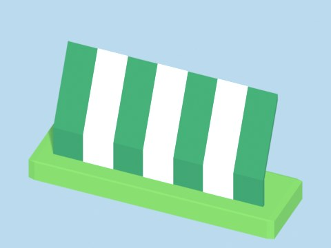 | [`toldo`](models/mobiliario/toldo.glb) | Green and white striped canvas awning (wall-mounted) | 78 |

### Cargo and industrial details · Carga e indústria (7)

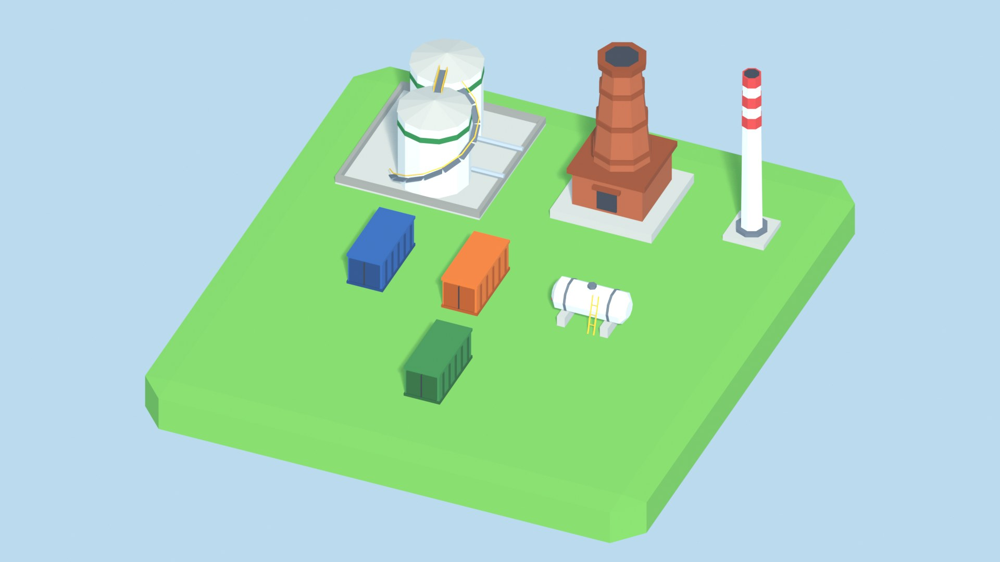

| | Model | Description | Tris |
|---|---|---|---:|
| 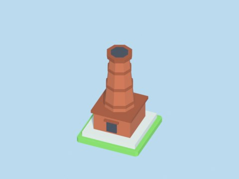 | [`chamine_grande`](models/carga/chamine_grande.glb) | Thick brick chimney of an old kiln or sugar mill | 228 |
| 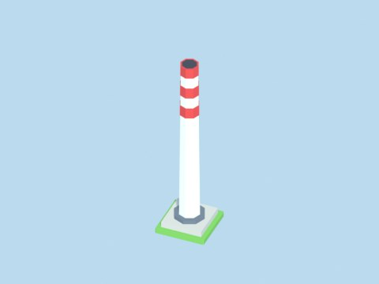 | [`chamine_media`](models/carga/chamine_media.glb) | Thin metal chimney with red and white bands | 180 |
| 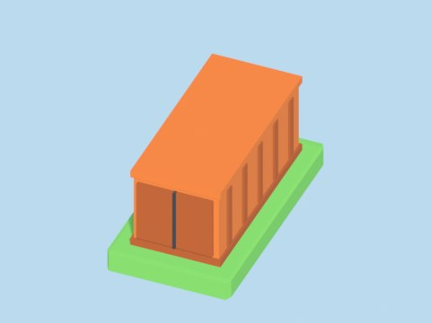 | [`conteiner_a`](models/carga/conteiner_a.glb) | Orange 20-foot shipping container | 120 |
| 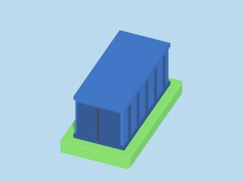 | [`conteiner_b`](models/carga/conteiner_b.glb) | Blue 20-foot shipping container | 120 |
| 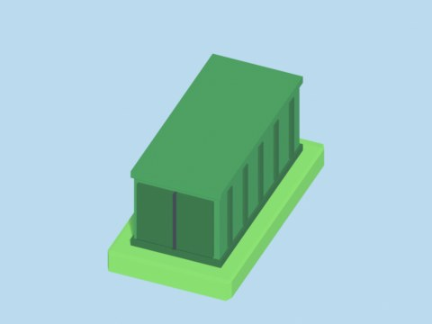 | [`conteiner_c`](models/carga/conteiner_c.glb) | Green 20-foot shipping container | 120 |
| 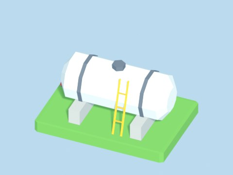 | [`tanque`](models/carga/tanque.glb) | Horizontal fuel/ethanol tank on concrete saddles | 288 |
|  | [`tanque_grande`](models/carga/tanque_grande.glb) | Two vertical ethanol tanks with catwalk and spiral stair | 536 |

<!-- catalogo:fim -->

## Build or modify the models

Every model is generated by a Python script for **Blender 4.5 LTS** — no hand-made meshes, so anything can be
changed and rebuilt:

```bash
blender -b --factory-startup --python src/residencial/casa_terrea.py   # one model → models/residencial/casa_terrea.glb
blender -b --factory-startup --python tools/medir.py -- residencial      # check sizes against tools/alvos.json
blender -b --factory-startup --python src/gerar_todos.py                 # all models + models/catalogo.json
blender -b --factory-startup --python src/vitrine.py -- tudo --cada      # preview renders in previews/
py -3 tools/atualizar_readme.py                                          # catalog in the READMEs and llms.txt
```

Shared helpers (boxes, cylinders, roofs, window rows, fences, trees) and the color palette are in
[`src/lib.py`](src/lib.py). Rules: front toward Blender -Y, flat colors from the palette only, no text, letters,
logos or real brands (signs are color bands), at most 1,500 triangles and 150 KB per model.

## FAQ

**Can I use these models in a commercial game?** Yes. They are CC0 1.0 (public domain): commercial use,
modification and redistribution are allowed, with no attribution required.

**What makes them "Brazilian"?** Details that are everywhere in Brazilian towns and rare in other kits: clay
(terracotta) tile roofs, front walls with iron gates, window grilles, blue fiber water tanks on roofs, exposed
*tijolo baiano* bricks on self-built houses with rebar sticking out of the slab, pastel paint, steel roll-up shop
doors, striped awnings, plastic bar tables, *pastilha* tiled facades, *cobogó* breeze blocks, fiber-cement sheds and
the concrete goblet water tower (*caixa d'água taça*).

**Which engines does it work with?** Any engine that imports glTF 2.0 binary (`.glb`): Godot 4, Unity (glTFast or
UnityGLTF), Unreal Engine 5 (glTF importer), three.js, Babylon.js, PlayCanvas and Blender.

**Are there textures or UVs?** No. Each color is a material with a flat base color, which keeps files small and
lets you recolor everything by changing the palette in `src/lib.py`.

**Can I make the houses grow in stages?** Yes — that is how Guardião da Água uses them: each zone lot starts as a
construction site and gets houses, shops or sheds in four stages. The same footprints line up on a grid.

**Is there people or text in the models?** No people, no letters or numbers and no real brands. Signs, the
helipad and the flags are plain color shapes.

## Origin and credits

The kit was born from the educational game [Guardião da Água](https://github.com/kayquer/guardiao_da_agua_js)
(*Water Guardian*), a product of Cláudia Dias Roxinol's master's research (Unesp, Presidente Prudente, Brazil),
developed with Kayque Rotondo, where it replaced the third-party city kits so the town looks Brazilian. It
complements the [Low Poly Brazil Props Kit](https://github.com/kayquer/kit-props-brasil-lowpoly), the
[Threatened Fauna Low Poly Kit](https://github.com/kayquer/kit-fauna-ameacada-lowpoly) and the
[Low Poly City Kit](https://github.com/kayquer/kit-cidade-lowpoly). The models and scripts were made with Blender,
with Claude (Anthropic) as an assistant. No third-party models are included in this repository.
