# Kit Prédios Brasil Low Poly: prédios 3D low poly de cidade brasileira, livres (CC0)

**🇬🇧 [Read in English](README.md)** · 🇧🇷 Português

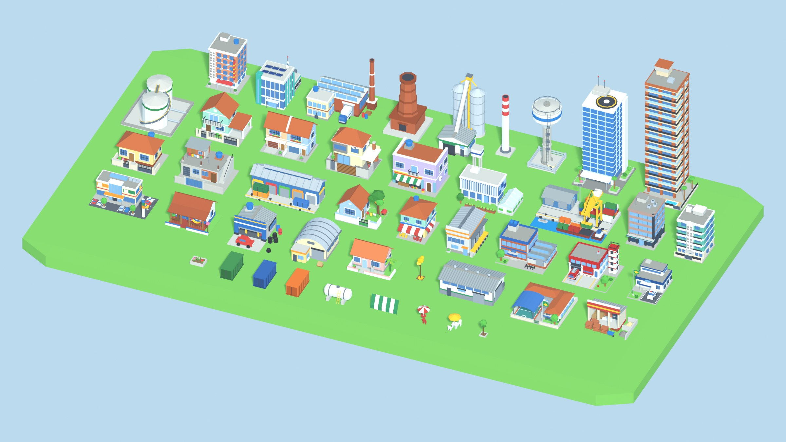

https://github.com/user-attachments/assets/f1f6d303-0ec5-45eb-af1f-7ccd48e04417

▶️ **[Assista ao vídeo no YouTube](https://www.youtube.com/watch?v=HUA-u5IVFIA)** · **[Baixe no itch.io](https://kkyqr.itch.io/low-poly-brazil-buildings-kit)** (grátis, doação opcional)

> **Resposta curta:** o Kit Prédios Brasil Low Poly é um pacote **livre, em domínio público (CC0 1.0)**, de
> **45 prédios 3D low poly em glTF/GLB** com cara de **cidade brasileira**: casa térrea com telha de barro, muro e
> portão de ferro, sobrado, casa de laje com tijolo baiano e caixa d'água azul, prédio de pastilha dos anos 70,
> padaria de esquina com toldo listrado, torre de vidro de avenida, galpão de telha de fibrocimento, fábrica com
> telhado shed, caixa d'água taça de cidade do interior, escola estadual com quadra coberta, quartel de bombeiros,
> porto de rio, contêineres, tanques e chaminés. Todo modelo tem **no máximo 1.500 triângulos**, cores chapadas e
> nenhuma textura. Funciona em Godot, Unity, Unreal, three.js, Babylon.js e Blender. Uso comercial liberado e
> atribuição opcional.

Quase todo kit de cidade gratuito tem cara de Estados Unidos ou Europa. Este nasceu porque um jogo educativo
brasileiro, o [Guardião da Água](https://github.com/kayquer/guardiao_da_agua_js), precisava de bairros que os
estudantes reconhecessem: **muro pintado, telha de barro, caixa d'água de fibra azul, grade na janela, porta de aço
de enrolar, cobogó e pastilha**. Serve para **city builders, simuladores, jogos educativos, estudos de arquitetura,
game jams e protótipos**.

**Domínio público ([CC0 1.0](LICENSE)).** Use como quiser, em projetos pessoais, educativos ou comerciais;
modifique e redistribua. Atribuição é opcional (veja [CITATION.cff](CITATION.cff)). Sem garantia.

**Conteúdo:** [Como usar](#como-usar) · [Catálogo](#catálogo) · [Gerar ou modificar](#gerar-ou-modificar-os-modelos) ·
[Perguntas frequentes](#perguntas-frequentes) · [Origem e créditos](#origem-e-créditos)

## Como usar

- Baixe o repositório (**Code → Download ZIP**) ou só os `.glb` que precisar em [`models/`](models).
- **Escala:** uma casa tem cerca de **1,3 unidade de largura e 0,8 de altura**; a medida exata de cada modelo
  (largura, fundo, altura) está em [`tools/alvos.json`](tools/alvos.json). Os modelos de um mesmo grupo têm a mesma
  escala, então dá para montar lotes e quadras. No Guardião da Água, 1 unidade = 0,65 célula do mapa.
- **Orientação:** Y para cima, fachada para **-Z** (convenção glTF); o lado direito (+X) também é caprichado,
  pensado para câmera isométrica. Todo modelo fica centrado e apoiado em y = 0.
- **Materiais:** um material por cor (PBR, só cor base, rugosidade 0,85). Para desenhar um bairro inteiro em poucas
  draw calls, converta as cores em cores de vértice e junte ou instancie os prédios.
- **Orçamento:** prédios entre 700 e 1.460 triângulos; detalhes (contêineres, toldos, guarda-sóis, árvores) entre
  78 e 540. Todo arquivo tem menos de 100 KB.
- **Combine** com os kits irmãos: [Kit Props Brasil Low Poly](https://github.com/kayquer/kit-props-brasil-lowpoly)
  (rua, natureza, sinais de poluição), [Kit Fauna Ameaçada Low Poly](https://github.com/kayquer/kit-fauna-ameacada-lowpoly)
  (bichos brasileiros ameaçados) e [Kit Cidade Low Poly](https://github.com/kayquer/kit-cidade-lowpoly) (água,
  saneamento e energia).

## Catálogo

<!-- catalogo:inicio -->
**45 modelos** em 7 categorias.

### Residencial · Residential (9)

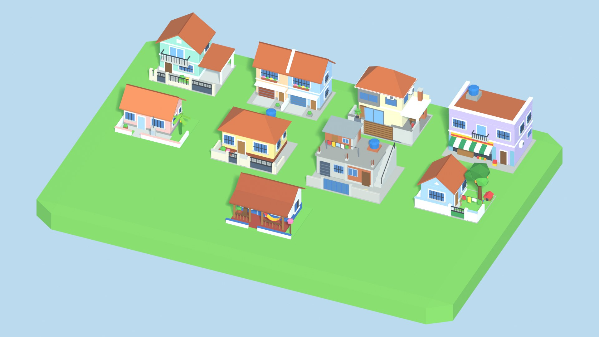

| | Modelo | Descrição | Tris |
|---|---|---|---:|
| 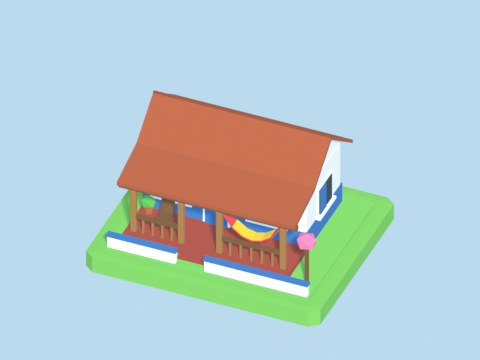 | [`casa_alpendre`](models/residencial/casa_alpendre.glb) | Casa branca com barra azul e alpendre na frente | 984 |
| 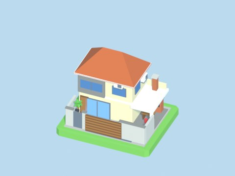 | [`casa_dois_andares`](models/residencial/casa_dois_andares.glb) | Casa nova de dois andares em creme e cinza grafite, com telhado de quatro águas de telha de barro, porta de vidro grande, ar-condicionado split na fachada, varanda gourmet com churrasqueira de tijolo e muro alto com portão de correr | 932 |
| 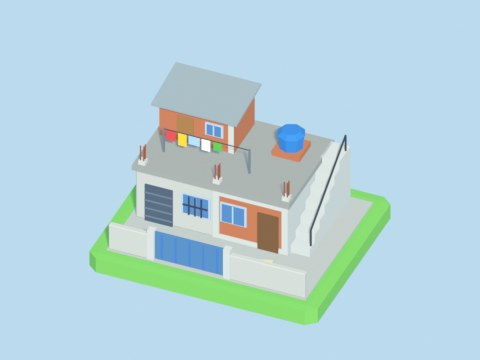 | [`casa_laje`](models/residencial/casa_laje.glb) | Casa de autoconstrução com laje | 1100 |
| 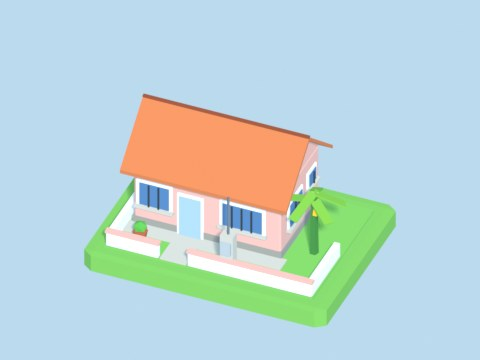 | [`casa_popular`](models/residencial/casa_popular.glb) | Casa popular de conjunto habitacional pintada de rosa pastel, pequena e simples, com telhado de duas águas de telha de barro, porta e duas janelas, murinho baixo na frente, padrão de luz e um pé de bananeira no quintal | 704 |
| 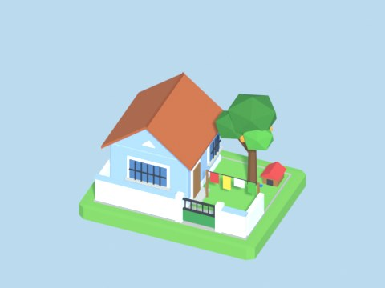 | [`casa_quintal`](models/residencial/casa_quintal.glb) | Casa azul pastel com quintal ao lado | 1052 |
| 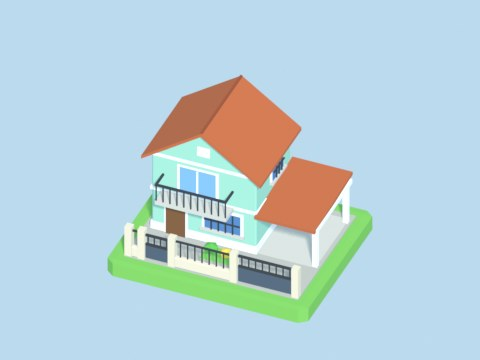 | [`casa_sobrado`](models/residencial/casa_sobrado.glb) | Sobrado verde-água de dois andares com oitão virado para a rua, telhado de duas águas de telha de barro, sacada com grade no andar de cima, garagem coberta ao lado e mureta com gradil e portão de ferro na frente | 1284 |
| 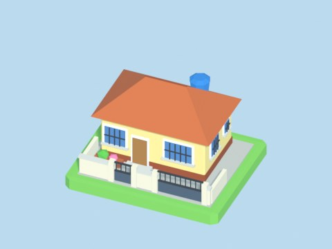 | [`casa_terrea`](models/residencial/casa_terrea.glb) | Casa térrea de bairro pintada de amarelo pastel, com telhado de quatro águas de telha de barro, caixa d'água azul aparecendo atrás, janelas com grade, barra colorida no rodapé e muro baixo com portão de ferro na frente | 1048 |
| 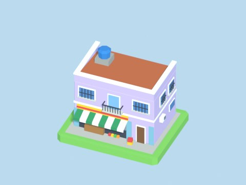 | [`sobrado_comercio`](models/residencial/sobrado_comercio.glb) | Sobrado misto lilás pastel | 1252 |
| 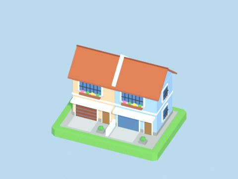 | [`sobrados_geminados`](models/residencial/sobrados_geminados.glb) | Dois sobrados geminados lado a lado, um pêssego e outro azul pastel, cada um com portão de garagem de chapa, porta, marquise e janela com grade em cima, telhado contínuo de telha de barro dividido por uma parede corta-fogo | 1184 |

### Comércio e prédios · Commercial and apartment buildings (7)

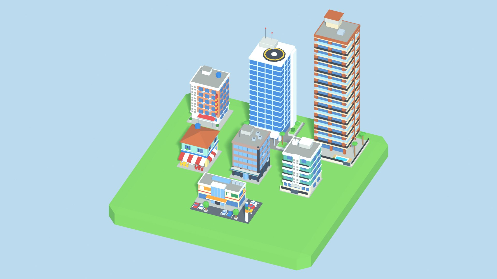

| | Modelo | Descrição | Tris |
|---|---|---|---:|
| 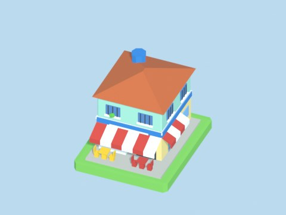 | [`padaria_toldo`](models/comercial/padaria_toldo.glb) | Padaria de esquina de dois andares | 1024 |
| 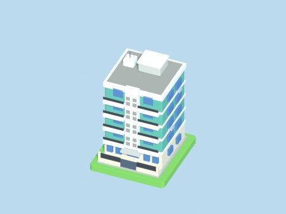 | [`predio_apartamentos`](models/comercial/predio_apartamentos.glb) | Prédio residencial de quatro andares sem elevador, estilo COHAB/BNH | 1176 |
| 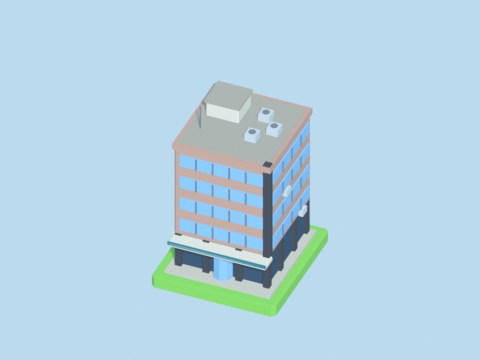 | [`predio_banco`](models/comercial/predio_banco.glb) | Edifício comercial de quatro andares revestido de granito rosa | 964 |
| 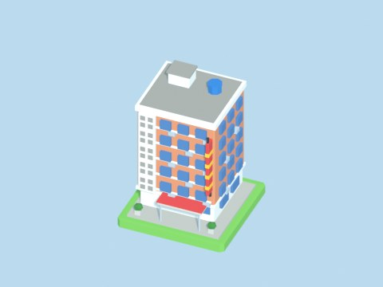 | [`predio_hotel`](models/comercial/predio_hotel.glb) | Hotel de centro de cidade com cinco andares | 1328 |
| 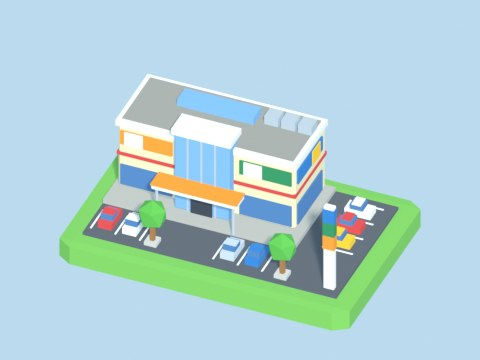 | [`shopping`](models/comercial/shopping.glb) | Shopping de bairro | 992 |
| 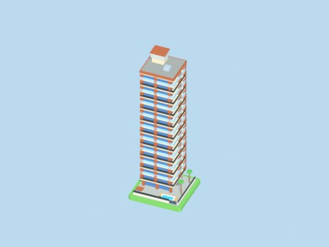 | [`torre_alta`](models/comercial/torre_alta.glb) | Prédio residencial alto de condomínio com dezoito andares | 1224 |
| 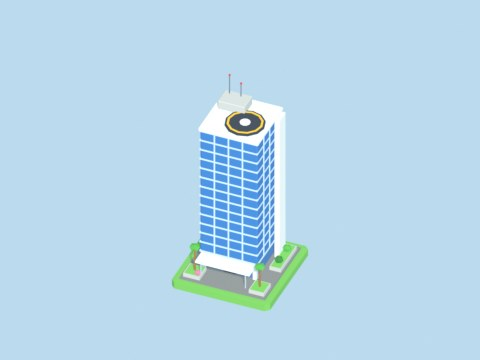 | [`torre_escritorios`](models/comercial/torre_escritorios.glb) | Torre de escritórios de vidro azul de avenida de capital | 984 |

### Indústria e galpões · Industrial and sheds (11)

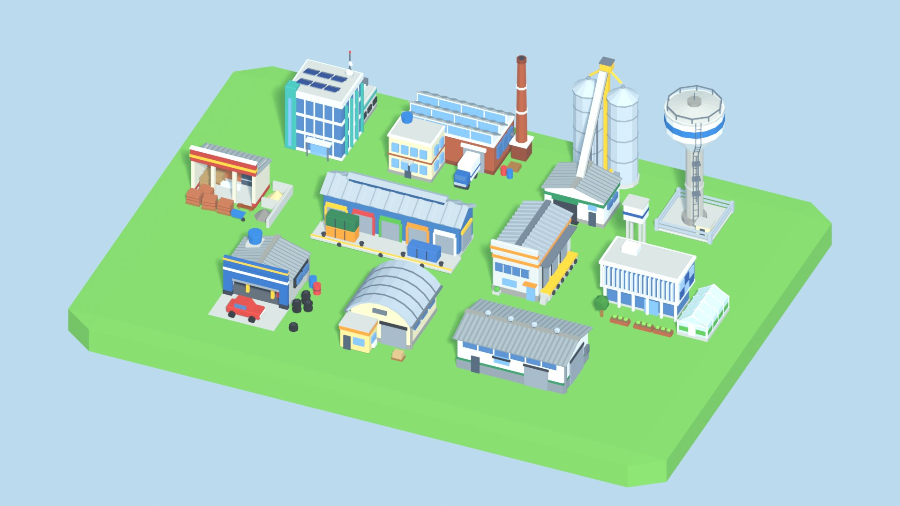

| | Modelo | Descrição | Tris |
|---|---|---|---:|
| 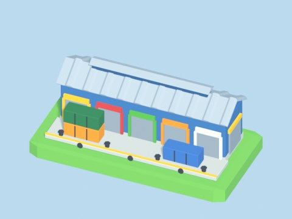 | [`armazem_porto`](models/industrial/armazem_porto.glb) | Armazém de porto | 1316 |
| 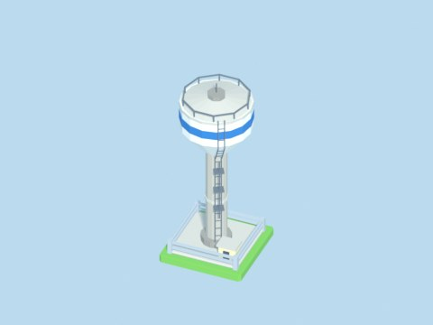 | [`caixa_dagua_taca`](models/industrial/caixa_dagua_taca.glb) | Caixa d'água elevada de concreto em forma de taça, das cidades do interior paulista e mineiro | 1300 |
| 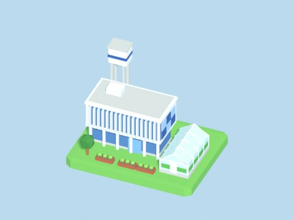 | [`centro_pesquisa`](models/industrial/centro_pesquisa.glb) | Instituto público de pesquisa no estilo modernista brasileiro (Embrapa, Fiocruz) | 1344 |
| 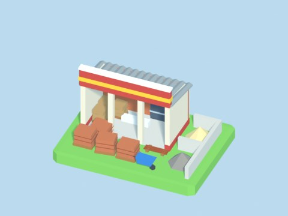 | [`deposito`](models/industrial/deposito.glb) | Depósito de material de construção | 910 |
| 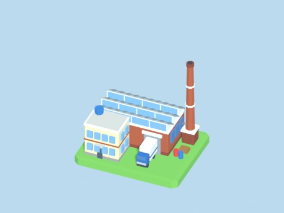 | [`fabrica`](models/industrial/fabrica.glb) | Fábrica de tijolinho aparente com telhado shed (dente de serra) de fibrocimento e vidraças viradas para a frente, chaminé alta de tijolo com anéis, bloco administrativo de dois andares pintado de creme na frente e portão de carga com um caminhão baú encostado | 1392 |
| 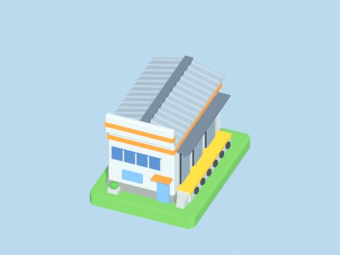 | [`galpao_carga`](models/industrial/galpao_carga.glb) | Galpão de distribuição (centro de distribuição) | 1096 |
| 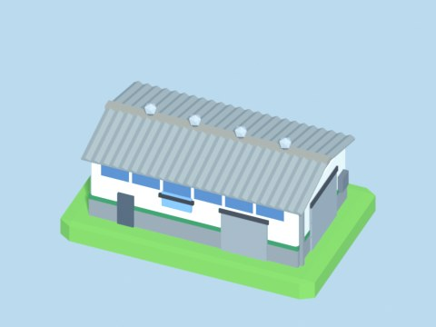 | [`galpao_comprido`](models/industrial/galpao_comprido.glb) | Galpão comprido de confecção ou metalúrgica | 920 |
| 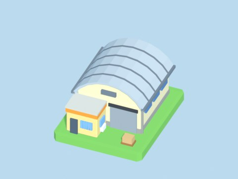 | [`galpao_pequeno`](models/industrial/galpao_pequeno.glb) | Galpão pequeno de telhado em arco (telha metálica curva com emendas), paredes creme, portão de aço de enrolar na frente e escritório colado na fachada, pintado de amarelo com faixa laranja e platibanda | 804 |
| 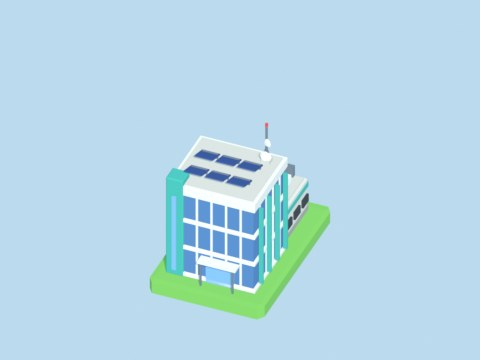 | [`galpao_tecnologia`](models/industrial/galpao_tecnologia.glb) | Prédio de polo tecnológico | 1272 |
| 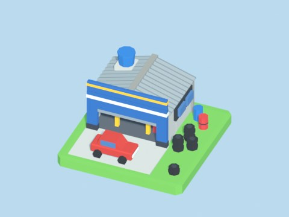 | [`oficina`](models/industrial/oficina.glb) | Oficina mecânica de bairro | 1344 |
| 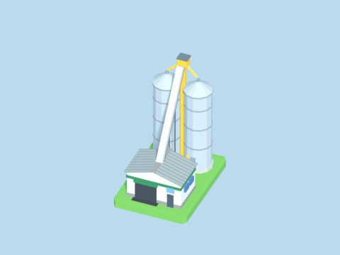 | [`silo_industria`](models/industrial/silo_industria.glb) | Indústria de alimentos (fábrica de ração ou beneficiadora de grãos) | 1236 |

### Prédios públicos · Public buildings (5)

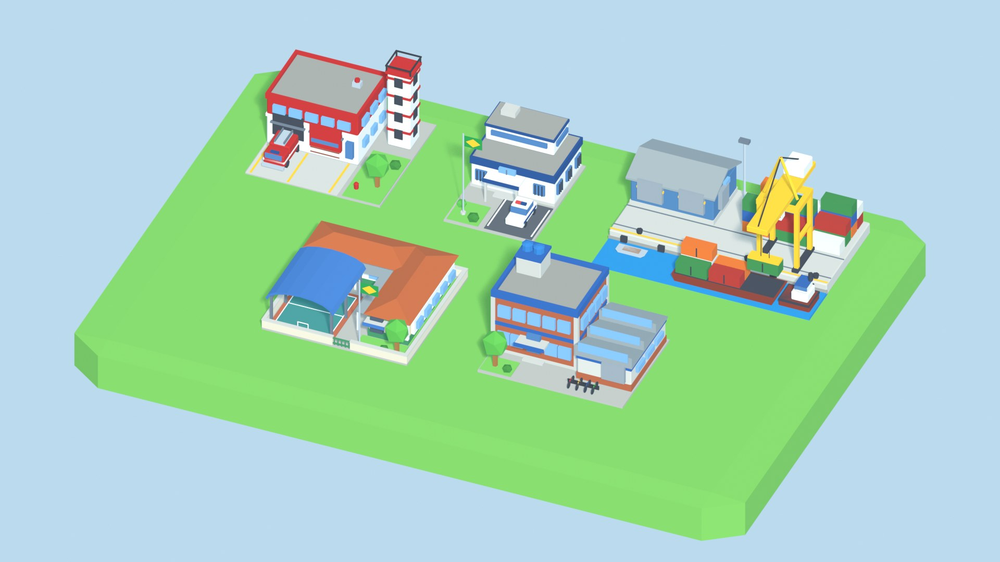

| | Modelo | Descrição | Tris |
|---|---|---|---:|
| 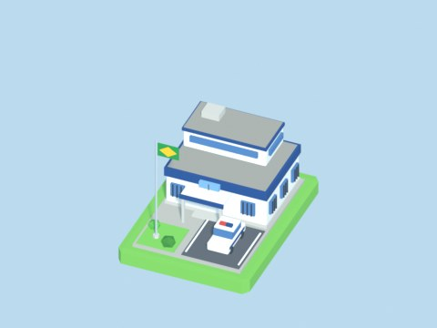 | [`delegacia`](models/publico/delegacia.glb) | Delegacia/base da polícia | 808 |
| 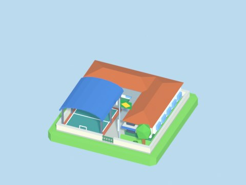 | [`escola_estadual`](models/publico/escola_estadual.glb) | Escola estadual térrea em L com barrado verde, janelas basculantes, corredor coberto, muro com portão, quadra poliesportiva com cobertura em arco e mastro com a bandeira verde-amarela | 1176 |
| 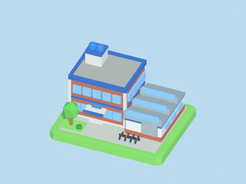 | [`escola_tecnica`](models/publico/escola_tecnica.glb) | Escola técnica no estilo ETEC/Instituto Federal | 1128 |
| 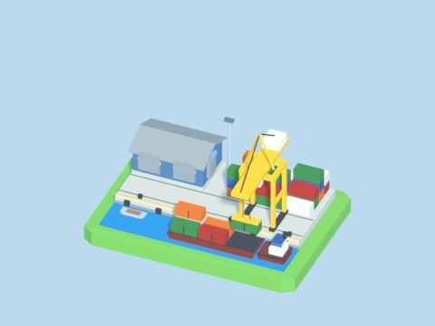 | [`porto`](models/publico/porto.glb) | Porto de rio | 1460 |
| 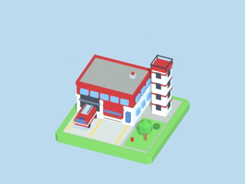 | [`quartel_bombeiros`](models/publico/quartel_bombeiros.glb) | Quartel do Corpo de Bombeiros vermelho e branco com dois portões largos (um aberto, com o caminhão vermelho saindo), pátio de manobra com faixas amarelas, hidrante e torre de treino alta e fina ao lado | 1096 |

### Verde de calçada · Street greenery (3)

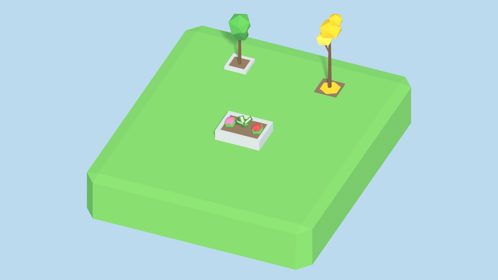

| | Modelo | Descrição | Tris |
|---|---|---|---:|
| 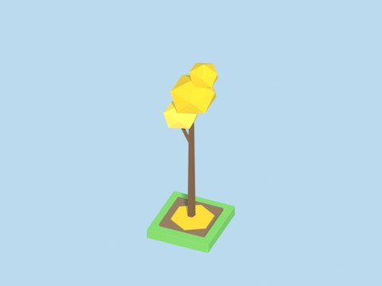 | [`arvore_ipe`](models/verde/arvore_ipe.glb) | Ipê-amarelo de calçada florido | 120 |
| 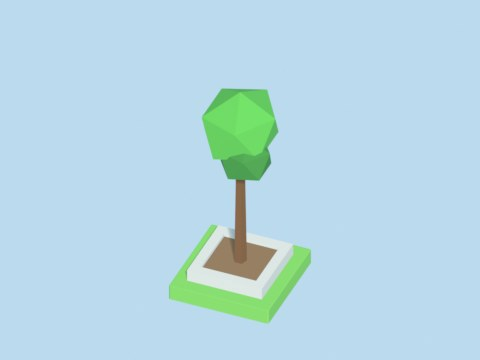 | [`arvore_pequena`](models/verde/arvore_pequena.glb) | Árvore pequena de calçada (oiti) | 116 |
| 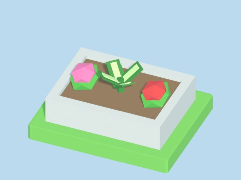 | [`jardineira`](models/verde/jardineira.glb) | Jardineira de calçada de concreto com terra, folhas grandes de comigo-ninguém-pode no meio e touceiras floridas de maria-sem-vergonha rosa e vermelha nas pontas | 248 |

### Mobiliário de comércio · Shop furniture (3)

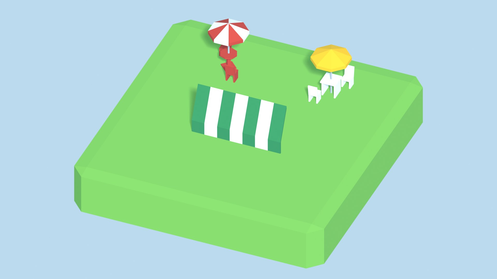

| | Modelo | Descrição | Tris |
|---|---|---|---:|
| 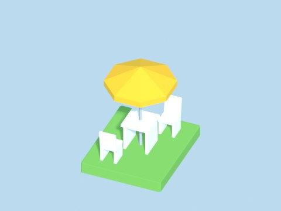 | [`guarda_sol_a`](models/mobiliario/guarda_sol_a.glb) | Guarda-sol de bar amarelo (sem marca) com mesa quadrada e duas cadeiras de plástico brancas, de calçada de boteco | 174 |
|  | [`guarda_sol_b`](models/mobiliario/guarda_sol_b.glb) | Guarda-sol de bar de esquina listrado de vermelho e branco, com mesa redonda e duas cadeiras de plástico vermelhas (sem marca) | 190 |
| 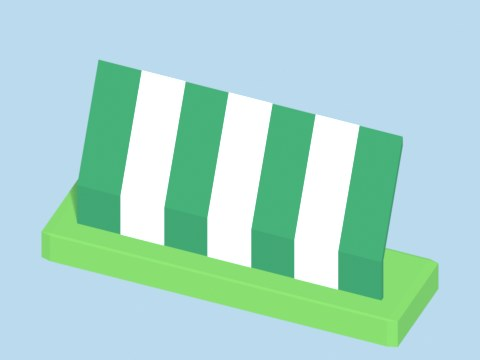 | [`toldo`](models/mobiliario/toldo.glb) | Toldo de lona listrado verde e branco de loja, inclinado e com saia na frente, para prender na fachada (a peça encosta na parede pelo lado +Y) | 78 |

### Carga e indústria · Cargo and industrial details (7)

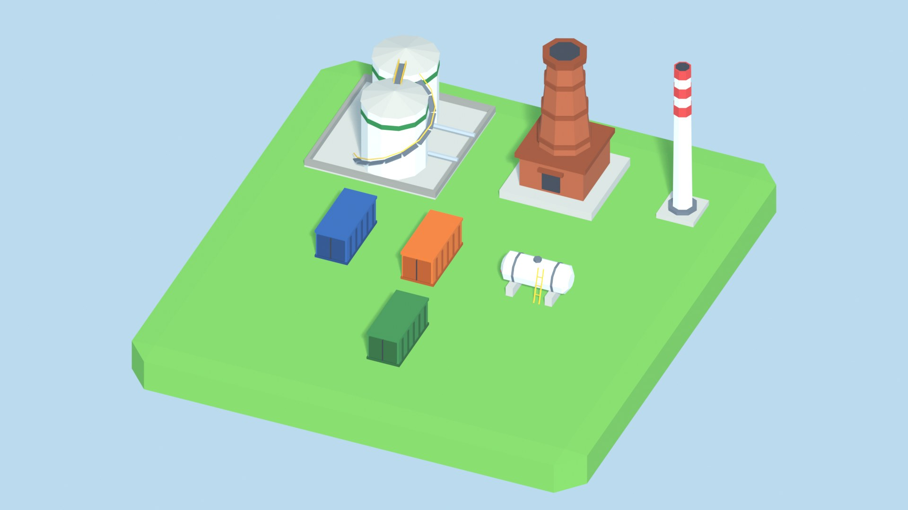

| | Modelo | Descrição | Tris |
|---|---|---|---:|
| 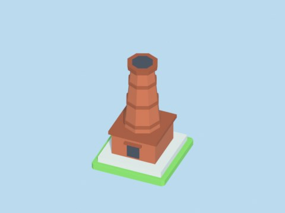 | [`chamine_grande`](models/carga/chamine_grande.glb) | Chaminé grossa de tijolo de olaria ou usina antiga | 228 |
| 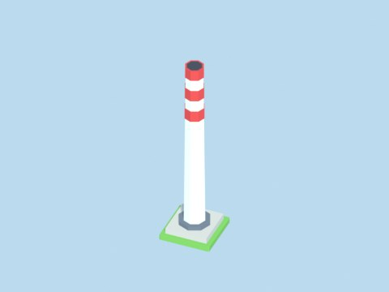 | [`chamine_media`](models/carga/chamine_media.glb) | Chaminé metálica fina de fábrica, branca com faixas vermelhas de sinalização no alto, flange chumbada numa base de concreto e boca escura | 180 |
| 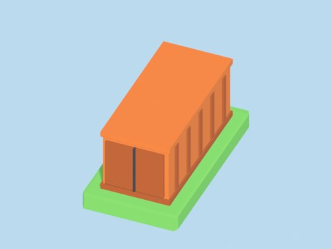 | [`conteiner_a`](models/carga/conteiner_a.glb) | Contêiner marítimo laranja de vinte pés com nervuras nas laterais, trilhos de base e topo e porta com tranca no fundo (frente para -Y) | 120 |
| 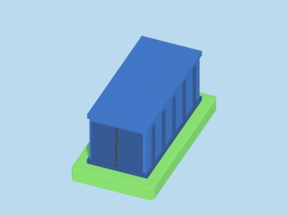 | [`conteiner_b`](models/carga/conteiner_b.glb) | Contêiner marítimo azul de vinte pés com nervuras nas laterais, trilhos de base e topo e porta com tranca no fundo (frente para -Y) | 120 |
| 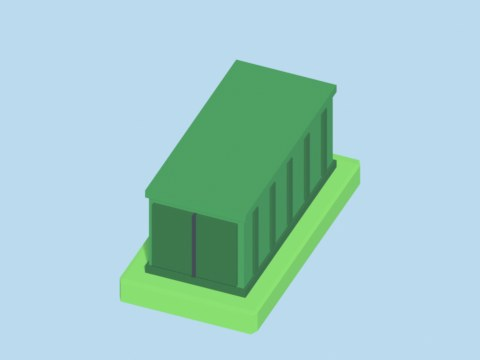 | [`conteiner_c`](models/carga/conteiner_c.glb) | Contêiner marítimo verde de vinte pés com nervuras nas laterais, trilhos de base e topo e porta com tranca no fundo (frente para -Y) | 120 |
|  | [`tanque`](models/carga/tanque.glb) | Tanque deitado de combustível/álcool, branco com cintas escuras, sobre dois berços de concreto, com boca de inspeção no topo, registro embaixo e escadinha amarela na frente | 288 |
|  | [`tanque_grande`](models/carga/tanque_grande.glb) | Dois tanques cilíndricos verticais brancos de usina de etanol, com faixa verde, teto cônico, passarela entre os topos, escada em espiral com corrimão amarelo e bacia de contenção de concreto | 536 |

<!-- catalogo:fim -->

## Gerar ou modificar os modelos

Cada modelo é gerado por um script Python para o **Blender 4.5 LTS** — nada modelado à mão, então tudo pode ser
mudado e gerado de novo:

```bash
blender -b --factory-startup --python src/residencial/casa_terrea.py   # um modelo → models/residencial/casa_terrea.glb
blender -b --factory-startup --python tools/medir.py -- residencial      # confere as medidas com tools/alvos.json
blender -b --factory-startup --python src/gerar_todos.py                 # todos + models/catalogo.json
blender -b --factory-startup --python src/vitrine.py -- tudo --cada      # renders em previews/
py -3 tools/atualizar_readme.py                                          # catálogo dos READMEs e do llms.txt
```

As peças comuns (caixas, cilindros, telhados, fileiras de janelas, cercas, árvores) e a paleta ficam em
[`src/lib.py`](src/lib.py). Regras: frente para -Y do Blender, só cores chapadas da paleta, sem texto, letras,
logos ou marcas reais (letreiro é faixa de cor), no máximo 1.500 triângulos e 150 KB por modelo.

## Perguntas frequentes

**Posso usar num jogo comercial?** Pode. Os modelos são CC0 1.0 (domínio público): uso comercial, modificação e
redistribuição liberados, sem precisar dar crédito.

**O que deixa os prédios com cara de Brasil?** Detalhes que estão em toda cidade brasileira e quase nunca aparecem
em outros kits: telha de barro, muro com portão de ferro, grade na janela, caixa d'água de fibra azul no telhado,
tijolo baiano aparente e ferro de espera saindo da laje na autoconstrução, pintura em tons pastel, porta de aço de
enrolar, toldo listrado, mesa de plástico de bar, fachada de pastilha, cobogó, galpão de fibrocimento e a caixa
d'água taça de concreto.

**Funciona em quais engines?** Em qualquer uma que importe glTF 2.0 binário (`.glb`): Godot 4, Unity (glTFast ou
UnityGLTF), Unreal Engine 5 (importador glTF), three.js, Babylon.js, PlayCanvas e Blender.

**Tem textura ou UV?** Não. Cada cor é um material de cor chapada: os arquivos ficam leves e dá para trocar as cores
de tudo mudando a paleta em `src/lib.py`.

**Dá para fazer o bairro crescer por fases?** Dá — é assim que o Guardião da Água usa: cada lote de zona começa como
canteiro de obras e ganha casas, lojas ou galpões em quatro fases. As plantas se encaixam numa grade.

**Tem gente ou texto nos modelos?** Não: nem pessoas, nem letras ou números, nem marcas reais. Letreiros, heliponto e
bandeiras são formas de cor.

## Origem e créditos

O kit nasceu do jogo educativo [Guardião da Água](https://github.com/kayquer/guardiao_da_agua_js), produto da
pesquisa de mestrado de Cláudia Dias Roxinol (Unesp, Presidente Prudente), desenvolvido com Kayque Rotondo, onde
substituiu os kits de cidade de terceiros para a cidade ter cara de Brasil. Ele complementa o
[Kit Props Brasil Low Poly](https://github.com/kayquer/kit-props-brasil-lowpoly), o
[Kit Fauna Ameaçada Low Poly](https://github.com/kayquer/kit-fauna-ameacada-lowpoly) e o
[Kit Cidade Low Poly](https://github.com/kayquer/kit-cidade-lowpoly). Os modelos e scripts foram feitos com o
Blender e com o Claude (Anthropic) como assistente. Nenhum modelo de terceiros faz parte deste repositório.
